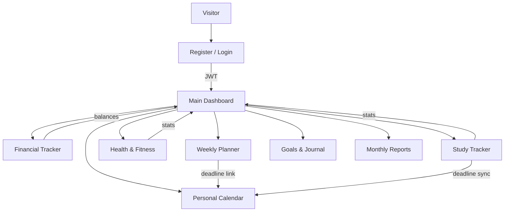

# LifeOS – Personal Life Management Dashboard — Product Requirements Document (PRD)

## 1. Product Overview

LifeOS is a full-stack personal life management dashboard that unifies finances, weekly planning (Covey 7-Habits), health & fitness, study tracking, calendar, goals and journaling in one authenticated workspace.
It targets students and busy individuals who want a single, elegant command center to plan, track and review every area of life; its value is one coherent system instead of scattered apps and spreadsheets.

## 2. Core Features

### 2.1 User Roles

| Role | Registration Method | Core Permissions |
|------|---------------------|------------------|
| Registered User | Email + password (JWT auth) | Full CRUD over their own private records across all modules |
| Demo User | Seeded demo account (`demo@lifeos.app`) | Same as registered user, pre-populated with realistic sample data |

### 2.2 Feature Module

1. **Authentication**: register, login, logout, protected routes, JWT session persistence.
2. **Main Dashboard (Overview)**: bank & piggy balances, today's tasks/priorities, weekly completion %, upcoming deadlines, hydration, upcoming events, study hours this week, exercise progress, current cycle phase (if enabled), quick actions.
3. **Financial Tracker**: bank balance, income, expenses by category, piggy-bank deposits/withdrawals, monthly summaries, spending-by-category & income-vs-expense charts.
4. **Weekly Planner (Covey)**: Mon–Sun table, tasks with title/description/date/time/priority (Q1–Q4)/status/life role, move between days, weekly goals, weekly review, optional private menstrual-cycle tracker.
5. **Health & Fitness**: weekly meal planner (breakfast/lunch/dinner/snacks), water tracker with goal + weekly history, body measurements with BMI + progress chart, weekly exercise table with completion + weekly stats.
6. **Study Tracker**: subjects/courses, study tasks, academic deadlines (exam/assignment/project/other), study sessions, completed tasks & total hours, upcoming/overdue, weekly stats & charts, deadline → calendar integration.
7. **Personal Calendar**: monthly/weekly/daily views, events (title/description/date/start/end/category), combined display of events + study deadlines + important tasks, category color distinction.
8. **Goals & Journal**: monthly/yearly goals by category with progress tracking; daily journal with mood, reflections, achievements, notes.
9. **Monthly Reports**: aggregated finances, tasks, study hours, exercise and hydration for a selected month.

### 2.3 Page Details

| Page Name | Module Name | Feature description |
|-----------|-------------|---------------------|
| Login / Register | Auth forms | Email + password forms, client + server validation, inline errors, loading states, redirect to dashboard |
| Dashboard | Overview cards | 8 stat cards (bank, piggy, today's tasks, completion %, deadlines, water, study hours, exercise), cycle phase card (conditional), quick-action buttons opening modals |
| Finances | Balance header | Bank balance + piggy balance cards computed from transactions |
| Finances | Transactions tables | Income & expense tables with add/edit/delete, category badges, date/amount/source/description |
| Finances | Piggy bank panel | Deposit/withdraw entries, running balance |
| Finances | Charts | Spending by category (pie) + monthly income vs expenses (bar) via Recharts |
| Finances | Filters & summary | Month selector, income/expense/savings totals |
| Planner | Week grid (Mon–Sun) | 7-day columns, tasks placed by date, drag/move via "move to day" control, complete toggle |
| Planner | Task modal | Create/edit: title, description, date, time, priority quadrant Q1–Q4, status, life role |
| Planner | Weekly goals & review | Add/complete goals; weekly review form (wins, challenges, rating, notes) |
| Planner | Cycle tracker | Optional private panel: period start, cycle length, period duration, current day & phase estimation, approximate cycle calendar, manual correction, phase suggestions |
| Health | Meal planner | Weekly grid × meal slots, add meal/ingredients/notes, mark consumed |
| Health | Water tracker | Daily goal setting, quick-add custom amounts, daily progress ring + weekly history |
| Health | Body measurements | Weight/height entry, auto BMI (adult screening label), monthly records + progress line chart |
| Health | Exercise tracker | Weekly table, add type/duration/date/notes, mark completed, weekly stats |
| Study | Subjects | Subject/course CRUD with color |
| Study | Study tasks | Task CRUD with priority + deadline, status, complete toggle |
| Study | Deadlines | Exam/assignment/project/other CRUD, upcoming + overdue sections |
| Study | Sessions | Session log (subject/date/start/duration/objectives), total hours + weekly chart |
| Calendar | Month/Week/Day views | View switcher, event CRUD, shows events + study deadlines + tasks with category colors |
| Goals | Goal list | Monthly/yearly, category filter, progress slider/percentage, completion toggle |
| Journal | Journal entries | Date-based entries, mood selector, reflections/achievements/notes |
| Reports | Monthly summary | Month picker, finance/task/study/exercise/hydration aggregates |
| Shell | Sidebar + Topbar | Collapsible sidebar navigation, top bar with user menu, notifications of overdue items, logout |

## 3. Core Process

A visitor registers or logs in (JWT issued and stored). Authenticated users land on the Dashboard and navigate modules via the sidebar. Every module performs full CRUD against the Express REST API, which persists to MongoDB scoped to the authenticated user. Cross-module integration keeps data consistent: creating an academic deadline (optionally) creates a linked calendar event (no duplicates on sync), tasks drive planner and dashboard, financial transactions recompute balances, and study/exercise/water records feed statistics and monthly reports.

## 4. User Interface Design

### 4.1 Design Style

- **Palette (warm, earthy, no blue/pink)**: cream `#F7F3EC`, warm white `#FFFDF8`, beige `#EDE4D6`, taupe `#C9B9A6` / `#A08C74`, dark brown text `#3E2F23`, deep espresso `#2A211A`. Accents: terracotta `#B4623A`, olive `#7A8450`, warm gold `#C08A3E`.
- **Buttons**: rounded (`rounded-lg`/`rounded-xl`), soft shadow, subtle hover lift; primary = espresso/terracotta fill with cream text; secondary = outline on beige.
- **Typography**: distinctive display serif for headings (e.g. "Fraunces") paired with a refined humanist body font (e.g. "Manrope"/"Nunito Sans"); 4–5 sizes, restrained weights.
- **Layout**: fixed/collapsible left sidebar + top bar, content in card-based grid, generous spacing, subtle grain/paper texture background.
- **Icons**: Lucide React, consistent 18–20px stroke icons; category color chips.

### 4.2 Page Design Overview

| Page Name | Module Name | UI Elements |
|-----------|-------------|-------------|
| Dashboard | Stat cards | Warm cream cards, taupe icons, large serif numerals, hover lift, staggered fade-in |
| Finances | Balance + charts | Two-tone balance hero, Recharts pie/bar in earth-tone palette, filter pills |
| Planner | Week grid | 7 columns with tactile day cards, quadrant color rails, drag-friendly rows |
| Calendar | View switcher | Segmented control, month grid with category dots, day agenda list |
| Forms/Modals | Reusable modal | Overlay blur, rounded panels, labeled inputs, inline validation, confirm dialogs for delete |

### 4.3 Responsiveness

Desktop-first grid layouts; tablet collapses sidebar to icon rail and stacks charts; mobile uses a slide-in sidebar (hamburger), single-column cards, horizontally scrollable week tables, and full-width modals. Touch targets ≥ 40px.

### 4.4 3D Scene Guidance

Not applicable — this is a data-focused dashboard, no 3D scene.
