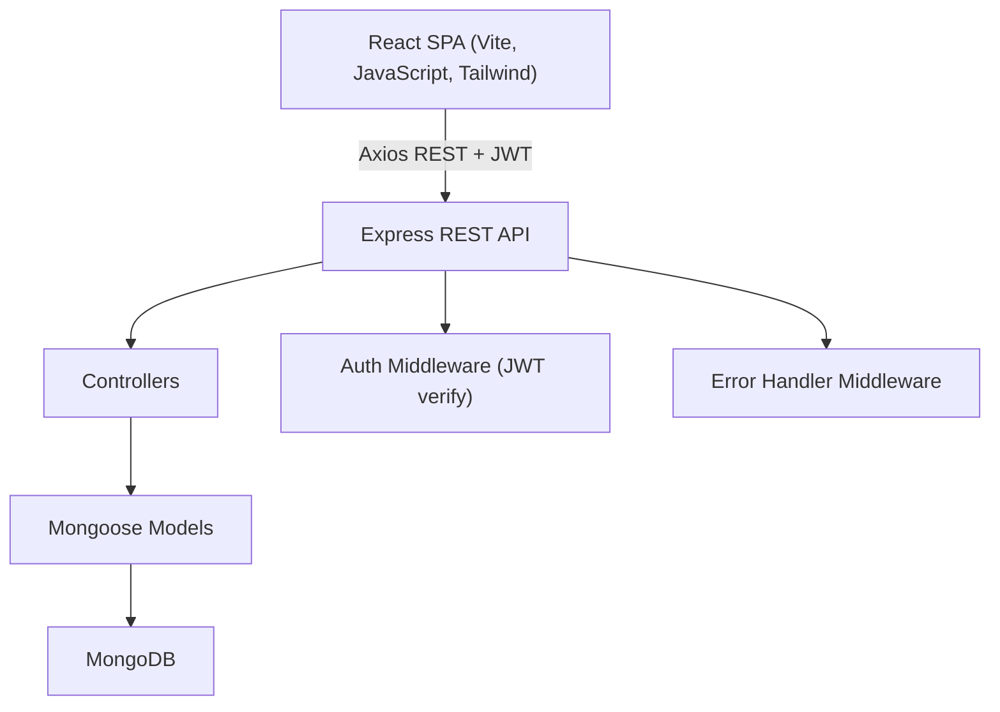
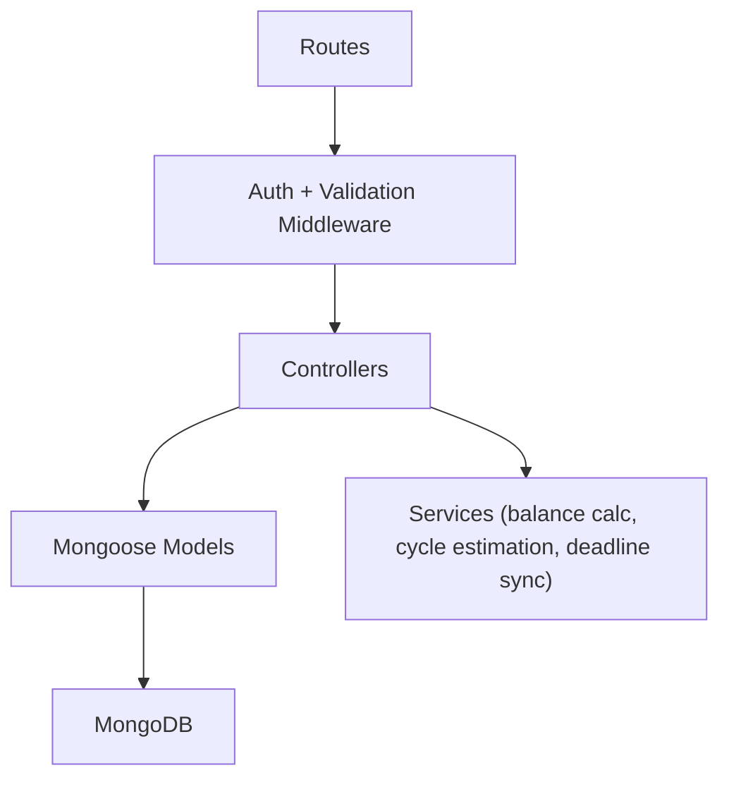
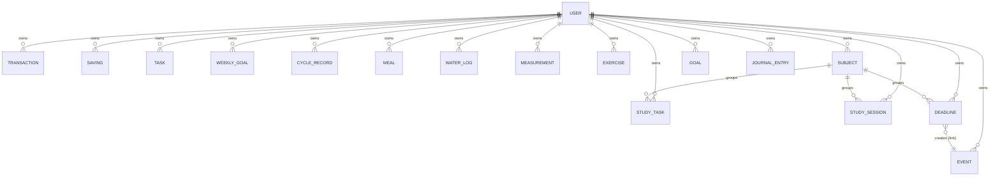

# LifeOS – Technical Architecture Document

## 1. Architecture Design

Two top-level folders: `/client` (React frontend) and `/server` (Express backend).

## 2. Technology Description

- Frontend: React 18 + Vite + JavaScript (JSX) + Tailwind CSS 3 + React Router 6 + Axios + Recharts + Lucide React.
- State management: React Context (Auth + Theme/toast) + custom hooks; local component state for module data.
- Backend: Node.js + Express 4 (ESM), Mongoose 8, JWT (`jsonwebtoken`), password hashing (`bcryptjs`), `cors`, `dotenv`, `express-validator` style manual validation, `morgan` logging.
- Database: MongoDB via Mongoose. `MONGODB_URI` env var; if absent and `mongodb-memory-server` is available (dev), the server auto-starts an in-memory MongoDB so the app runs out-of-the-box, with a clear console notice. Default URI: `mongodb://127.0.0.1:27017/lifeos`.
- Dev tooling: `nodemon` for the server, Vite dev server proxy `/api` → `http://localhost:5000`.

## 3. Route Definitions (Client)

| Route | Purpose |
|-------|---------|
| /login | Login page |
| /register | Registration page |
| / | Main dashboard overview |
| /finances | Financial tracker |
| /planner | Weekly planner (Covey) + cycle tracker |
| /health | Health & fitness (diet, water, measurements, exercise) |
| /study | Study tracker (subjects, tasks, deadlines, sessions) |
| /calendar | Personal calendar (month/week/day) |
| /goals | Goals (monthly/yearly) |
| /journal | Daily journal |
| /reports | Monthly reports |
| /settings | Profile + cycle feature toggle |

All routes except `/login` and `/register` are wrapped in a `ProtectedRoute`.

## 4. API Definitions

Base URL: `/api`. All endpoints except auth require header `Authorization: Bearer <token>`.

### Auth
- `POST /api/auth/register` → `{ name, email, password }` → `{ token, user }`
- `POST /api/auth/login` → `{ email, password }` → `{ token, user }`
- `GET /api/auth/me` → `{ user }`
- `PUT /api/auth/preferences` → `{ cycleTrackingEnabled }` → `{ user }`

### Resources (uniform CRUD: `GET /`, `POST /`, `PUT /:id`, `DELETE /:id`)
| Resource | Path | Key fields |
|----------|------|-----------|
| Transactions | /api/transactions | type(income/expense), amount, date, category, source, description |
| Savings | /api/savings | type(deposit/withdrawal), amount, date, description |
| Tasks | /api/tasks | title, description, date, time, priority(Q1–Q4), status, role, completed |
| Weekly goals | /api/weekly-goals | title, description, weekStart, completed |
| Weekly review | /api/weekly-review | weekStart, wins, challenges, rating, notes (GET ?week=, PUT) |
| Cycle records | /api/cycle | periodStart, cycleLength, periodDuration, notes |
| Meals | /api/meals | date, mealType, name, ingredients, notes, consumed |
| Water | /api/water | date, amount, goal (GET ?date=/?range=) |
| Measurements | /api/measurements | date, weightKg, heightCm, notes (bmi computed) |
| Exercises | /api/exercises | date, type, durationMin, notes, completed |
| Subjects | /api/subjects | name, code, instructor, color |
| Study tasks | /api/study-tasks | subject, title, description, priority, deadline, status, completed |
| Study sessions | /api/study-sessions | subject, date, startTime, durationMin, objectives, notes |
| Deadlines | /api/deadlines | subject, title, type, dueDate, description |
| Events | /api/events | title, description, date, startTime, endTime, category, source, sourceRef |
| Goals | /api/goals | title, description, category, period(monthly/yearly), targetDate, progress, completed |
| Journal | /api/journal | date, reflections, achievements, mood, notes |

### Aggregation
- `GET /api/finance/summary?month=YYYY-MM` → `{ bankBalance, piggyBalance, income, expenses, savings, byCategory[], monthly[] }`
- `GET /api/dashboard` → consolidated overview payload
- `GET /api/reports/monthly?month=YYYY-MM` → consolidated monthly report
- `GET /api/calendar?from=&to=` → merged events + deadlines + tasks

## 5. Server Architecture Diagram

## 6. Data Model

### 6.1 Data Model Definition

Every document carries `user: ObjectId ref User` and is always queried with `user: req.user.id` to enforce isolation.

### 6.2 Data Definition Language (Mongoose collections & indexes)

- `users`: name, email(unique), password(hash), cycleTrackingEnabled(bool), timestamps.
- `transactions`: user(idx), type enum, amount, date(idx), category enum, source, description, timestamps.
- `savings`: user(idx), type enum, amount, date(idx), description, timestamps.
- `tasks`: user(idx), title, description, date(idx), time, priority enum Q1–Q4, status enum, role enum, completed, timestamps.
- `weeklygoals`: user(idx), title, description, weekStart(idx), completed, timestamps.
- `weeklyreviews`: user(idx)+weekStart unique, wins, challenges, rating, notes, timestamps.
- `cyclerecords`: user(idx), periodStart(idx), cycleLength, periodDuration, notes, timestamps.
- `meals`: user(idx), date(idx), mealType enum, name, ingredients, notes, consumed, timestamps.
- `waterlogs`: user(idx)+date unique, amount, goal (default 2000ml), timestamps.
- `measurements`: user(idx), date(idx), weightKg, heightCm, bmi, notes, timestamps.
- `exercises`: user(idx), date(idx), type, durationMin, notes, completed, timestamps.
- `subjects`: user(idx), name, code, instructor, color, timestamps.
- `studytasks`: user(idx), subject(ref), title, description, priority enum, deadline(idx), status enum, completed, timestamps.
- `studysessions`: user(idx), subject(ref), date(idx), startTime, durationMin, objectives, notes, timestamps.
- `deadlines`: user(idx), subject(ref nullable), title, type enum, dueDate(idx), description, linkedEvent(ref), timestamps.
- `events`: user(idx), title, description, date(idx), startTime, endTime, category enum, source enum(manual/study/task), sourceRef, timestamps.
- `goals`: user(idx), title, description, category enum, period enum, targetDate, progress, completed, timestamps.
- `journalentries`: user(idx)+date unique, reflections, achievements, mood enum, notes, timestamps.

Balance calculation (transaction-based, idempotent): `bankBalance = Σ income − Σ expenses`; `piggyBalance = Σ deposits − Σ withdrawals`. Balances are always recomputed from stored transactions, so edits/deletes never double-count.

Cycle estimation: from the most recent `periodStart` and `cycleLength`, `cycleDay = ((today − periodStart) mod cycleLength) + 1`; phase derived from configurable thresholds (menstrual → follicular → ovulation → luteal). Suggestions are framed as optional and non-universal.

## 7. Environment Variables

Server (`/server/.env`): `PORT`, `MONGODB_URI`, `JWT_SECRET`, `JWT_EXPIRES_IN`, `CLIENT_ORIGIN`.
Client (`/client/.env`): `VITE_API_URL` (defaults to `/api` via Vite proxy).
Both ship with `.env.example` files.

## 8. Demo & Seed Data

`npm run seed` in `/server` creates a demo user `demo@lifeos.app` / `demo1234` and realistic sample records across all modules (transactions, savings, tasks, goals, cycle record, meals, water, measurements, exercises, subjects, study tasks, sessions, deadlines, events, goals, journal).
